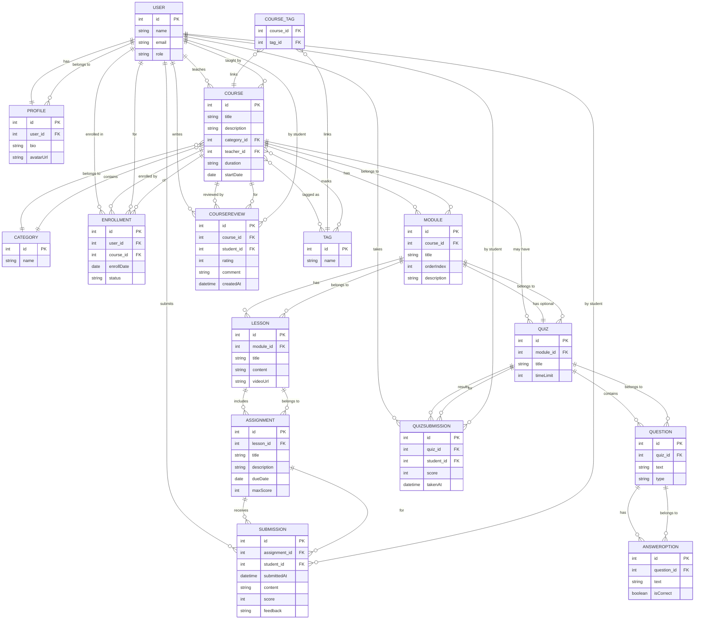

# Hibernate Learning Platform

Учебная платформа для онлайн-курса по ORM и Hibernate. Spring Boot приложение с PostgreSQL, Spring Data JPA, Hibernate, REST API, интеграционными тестами на Testcontainers и демонстрационными данными.

Проект демонстрирует полноценную ORM-модель из 15 сущностей со связями «один к одному», «один ко многим» и «многие ко многим», работу с ленивой загрузкой и способами обхода `LazyInitializationException`, каскады, бизнес-правила и централизованную обработку ошибок.

## Технологии

| Технология              | Версия                                        |
| ----------------------- | --------------------------------------------- |
| Java                    | 17 (сборка и тесты также проверены на JDK 21) |
| Spring Boot             | 3.5.6                                         |
| Hibernate ORM           | 6.6.29.Final                                  |
| PostgreSQL              | 16.4                                          |
| Spring Data JPA         | из Spring Boot 3.5.6                          |
| Bean Validation         | из Spring Boot 3.5.6                          |
| Lombok                  | 1.18.38                                       |
| Springdoc OpenAPI       | 2.8.9                                         |
| JUnit 5 / AssertJ       | из Spring Boot 3.5.6                          |
| Testcontainers          | 1.21.3                                        |
| JaCoCo                  | 0.8.13                                        |
| Spotless                | 2.44.5                                        |
| Checkstyle              | 10.21.4 (plugin 3.6.0)                        |
| Maven                   | 3.9+                                          |
| Docker / docker-compose | актуальные версии                             |

## Архитектура

Слои внутри пакета `hibernate.learning.platform`:

```text
hibernate.learning.platform
├── domain                 домен: сущности, enum'ы, исключения, чистые доменные сервисы
│   ├── entity
│   ├── enums
│   ├── exception
│   └── service
├── repository             Spring Data JPA репозитории, @EntityGraph и JPQL fetch-запросы
├── service                прикладная логика, транзакции, бизнес-правила
├── web                    REST-контроллеры, DTO, обработка ошибок
│   ├── controller
│   ├── dto
│   │   ├── request
│   │   └── response
│   └── exception
└── config                 конфигурация: Clock, OpenAPI, загрузка демо-данных
```

Правила:

- JPA-сущности не зависят от Web-слоя и Spring MVC.
- Бизнес-правила живут в домене и сервисном слое, контроллеры только мапят DTO.
- В API возвращаются DTO-записи (`record`), а не JPA-сущности.
- Все связи настроены на `FetchType.LAZY`, `spring.jpa.open-in-view=false`.
- Нужные графы загружаются через `@EntityGraph`, JPQL `join fetch` или внутри транзакционного метода сервиса.
- Инварианты сущностей проверяются в конструкторах и фабричных методах (`DomainPreconditions`).
- Время инжектируется через `java.time.Clock` (`ClockConfig`), что делает логику тестируемой.
- Параметры подключения и секреты берутся только из конфигурации и переменных окружения.

## Модель данных

Реализовано 15 JPA-сущностей и `AbstractEntity` (`@MappedSuperclass` с `@Id`, `@GeneratedValue(IDENTITY)` и корректными `equals`/`hashCode` через `Hibernate.getClass`).

| Сущность         | Таблица            | Назначение                               |
| ---------------- | ------------------ | ---------------------------------------- |
| `User`           | `users`            | Студент, преподаватель или администратор |
| `Profile`        | `profiles`         | Дополнительные сведения о пользователе   |
| `Category`       | `categories`       | Категория курса                          |
| `Course`         | `courses`          | Учебный курс                             |
| `Enrollment`     | `enrollments`      | Запись студента на курс                  |
| `Module`         | `modules`          | Модуль курса                             |
| `Lesson`         | `lessons`          | Урок модуля                              |
| `Assignment`     | `assignments`      | Домашнее задание урока                   |
| `Submission`     | `submissions`      | Решение задания студентом                |
| `Quiz`           | `quizzes`          | Тест модуля                              |
| `Question`       | `questions`        | Вопрос теста                             |
| `AnswerOption`   | `answer_options`   | Вариант ответа на вопрос                 |
| `QuizSubmission` | `quiz_submissions` | Результат прохождения теста              |
| `CourseReview`   | `course_reviews`   | Отзыв студента о курсе                   |
| `Tag`            | `tags`             | Тег курса                                |

Промежуточная таблица `course_tag` создаётся для связи «многие ко многим» между курсами и тегами. Итого в схеме 16 таблиц.

### Типы связей

| Тип                    | Примеры                                                                                                                             |
| ---------------------- | ----------------------------------------------------------------------------------------------------------------------------------- |
| One-to-One             | `User` ↔ `Profile`, `Module` ↔ `Quiz`                                                                                               |
| One-to-Many            | `Course` → `Module`, `Module` → `Lesson`, `Lesson` → `Assignment`, `Quiz` → `Question`, `Question` → `AnswerOption`                 |
| Many-to-One            | `Course` → `Category`, `Course` → `User`, `Submission` → `Assignment`, `QuizSubmission` → `Quiz`                                    |
| Many-to-Many           | `Course` ↔ `Tag` через `course_tag`                                                                                                 |
| Промежуточная сущность | `Enrollment` (студент + курс), `Submission` (студент + задание), `QuizSubmission` (студент + тест), `CourseReview` (студент + курс) |

### Ограничения целостности

| Ограничение                                                            | Таблица              |
| ---------------------------------------------------------------------- | -------------------- |
| Уникальный email                                                       | `users`              |
| Уникальное имя                                                         | `categories`, `tags` |
| Уникальная пара преподаватель + название (`uk_course_teacher_title`)   | `courses`            |
| Уникальная пара студент + курс (`uk_enrollment_student_course`)        | `enrollments`        |
| Уникальная пара студент + курс (`uk_course_review_student_course`)     | `course_reviews`     |
| Уникальная пара студент + задание (`uk_submission_student_assignment`) | `submissions`        |
| Уникальный порядок модуля в курсе (`uk_module_course_order`)           | `modules`            |
| Уникальный порядок урока в модуле (`uk_lesson_module_order`)           | `lessons`            |
| Один тест на модуль                                                    | `quizzes`            |
| Один профиль на пользователя                                           | `profiles`           |

### ER-диаграмма



## Структура проекта

```text
.
├── .github
│   └── workflows
│       └── ci.yml
├── .dockerignore
├── .editorconfig
├── .env.example
├── .gitignore
├── Dockerfile
├── LICENSE
├── README.md
├── checkstyle.xml
├── docker-compose.yml
├── pom.xml
└── src
    ├── main
    │   ├── java/hibernate/learning/platform
    │   │   ├── Main.java
    │   │   ├── config
    │   │   │   ├── ClockConfig.java
    │   │   │   ├── DemoDataLoader.java
    │   │   │   └── OpenApiConfig.java
    │   │   ├── domain
    │   │   │   ├── DomainPreconditions.java
    │   │   │   ├── entity
    │   │   │   │   ├── AbstractEntity.java
    │   │   │   │   ├── AnswerOption.java
    │   │   │   │   ├── Assignment.java
    │   │   │   │   ├── Category.java
    │   │   │   │   ├── Course.java
    │   │   │   │   ├── CourseReview.java
    │   │   │   │   ├── Enrollment.java
    │   │   │   │   ├── Lesson.java
    │   │   │   │   ├── Module.java
    │   │   │   │   ├── Profile.java
    │   │   │   │   ├── Question.java
    │   │   │   │   ├── Quiz.java
    │   │   │   │   ├── QuizSubmission.java
    │   │   │   │   ├── Submission.java
    │   │   │   │   ├── Tag.java
    │   │   │   │   └── User.java
    │   │   │   ├── enums
    │   │   │   │   ├── EnrollmentStatus.java
    │   │   │   │   ├── QuestionType.java
    │   │   │   │   ├── SubmissionStatus.java
    │   │   │   │   └── UserRole.java
    │   │   │   ├── exception
    │   │   │   │   ├── BusinessRuleViolationException.java
    │   │   │   │   ├── DomainException.java
    │   │   │   │   ├── DuplicateResourceException.java
    │   │   │   │   ├── InvalidDomainStateException.java
    │   │   │   │   └── ResourceNotFoundException.java
    │   │   │   └── service
    │   │   │       └── QuizScoreCalculator.java
    │   │   ├── repository
    │   │   │   ├── AnswerOptionRepository.java
    │   │   │   ├── AssignmentRepository.java
    │   │   │   ├── CategoryRepository.java
    │   │   │   ├── CourseRepository.java
    │   │   │   ├── CourseReviewRepository.java
    │   │   │   ├── EnrollmentRepository.java
    │   │   │   ├── LessonRepository.java
    │   │   │   ├── ModuleRepository.java
    │   │   │   ├── ProfileRepository.java
    │   │   │   ├── QuestionRepository.java
    │   │   │   ├── QuizRepository.java
    │   │   │   ├── QuizSubmissionRepository.java
    │   │   │   ├── SubmissionRepository.java
    │   │   │   ├── TagRepository.java
    │   │   │   └── UserRepository.java
    │   │   ├── service
    │   │   │   ├── AnswerOptionService.java
    │   │   │   ├── AssignmentService.java
    │   │   │   ├── CategoryService.java
    │   │   │   ├── CourseReviewService.java
    │   │   │   ├── CourseService.java
    │   │   │   ├── EnrollmentService.java
    │   │   │   ├── LessonService.java
    │   │   │   ├── ModuleService.java
    │   │   │   ├── ProfileService.java
    │   │   │   ├── QuestionService.java
    │   │   │   ├── QuizService.java
    │   │   │   ├── QuizSubmissionService.java
    │   │   │   ├── SubmissionService.java
    │   │   │   ├── TagService.java
    │   │   │   └── UserService.java
    │   │   └── web
    │   │       ├── controller
    │   │       │   ├── AnswerOptionController.java
    │   │       │   ├── AssignmentController.java
    │   │       │   ├── CategoryController.java
    │   │       │   ├── CourseController.java
    │   │       │   ├── CourseReviewController.java
    │   │       │   ├── EnrollmentController.java
    │   │       │   ├── LessonController.java
    │   │       │   ├── ModuleController.java
    │   │       │   ├── QuestionController.java
    │   │       │   ├── QuizController.java
    │   │       │   ├── QuizSubmissionController.java
    │   │       │   ├── SubmissionController.java
    │   │       │   ├── TagController.java
    │   │       │   └── UserController.java
    │   │       ├── dto
    │   │       │   ├── request
    │   │       │   │   ├── AnswerOptionRequest.java
    │   │       │   │   ├── AssignmentRequest.java
    │   │       │   │   ├── CategoryRequest.java
    │   │       │   │   ├── CourseCreateRequest.java
    │   │       │   │   ├── CourseReviewRequest.java
    │   │       │   │   ├── CourseReviewUpdateRequest.java
    │   │       │   │   ├── CourseUpdateRequest.java
    │   │       │   │   ├── GradeSubmissionRequest.java
    │   │       │   │   ├── LessonRequest.java
    │   │       │   │   ├── ModuleRequest.java
    │   │       │   │   ├── ProfileRequest.java
    │   │       │   │   ├── QuestionRequest.java
    │   │       │   │   ├── QuizRequest.java
    │   │       │   │   ├── SubmissionRequest.java
    │   │       │   │   ├── TagRequest.java
    │   │       │   │   ├── TakeQuizRequest.java
    │   │       │   │   └── UserRequest.java
    │   │       │   └── response
    │   │       │       ├── AnswerOptionResponse.java
    │   │       │       ├── AnswerOptionSummaryResponse.java
    │   │       │       ├── ApiError.java
    │   │       │       ├── AssignmentReferenceResponse.java
    │   │       │       ├── AssignmentResponse.java
    │   │       │       ├── CategoryResponse.java
    │   │       │       ├── CourseDetailResponse.java
    │   │       │       ├── CourseReferenceResponse.java
    │   │       │       ├── CourseResponse.java
    │   │       │       ├── CourseReviewResponse.java
    │   │       │       ├── EnrollmentResponse.java
    │   │       │       ├── LessonReferenceResponse.java
    │   │       │       ├── LessonResponse.java
    │   │       │       ├── LessonSummaryResponse.java
    │   │       │       ├── ModuleReferenceResponse.java
    │   │       │       ├── ModuleResponse.java
    │   │       │       ├── ModuleSummaryResponse.java
    │   │       │       ├── ProfileResponse.java
    │   │       │       ├── QuestionResponse.java
    │   │       │       ├── QuestionSummaryResponse.java
    │   │       │       ├── QuizDetailResponse.java
    │   │       │       ├── QuizReferenceResponse.java
    │   │       │       ├── QuizResponse.java
    │   │       │       ├── QuizSubmissionResponse.java
    │   │       │       ├── SubmissionResponse.java
    │   │       │       ├── TagResponse.java
    │   │       │       ├── UserResponse.java
    │   │       │       └── ValidationError.java
    │   │       └── exception
    │   │           └── GlobalExceptionHandler.java
    │   └── resources
    │       └── application.yml
    └── test
        └── java/hibernate/learning/platform
            ├── domain
            │   ├── DomainModelTest.java
            │   └── service
            │       └── QuizScoreCalculatorTest.java
            ├── integration
            │   ├── ContentManagementIntegrationTest.java
            │   ├── CoreFlowIntegrationTest.java
            │   ├── LazyLoadingIntegrationTest.java
            │   └── QuizManagementIntegrationTest.java
            ├── testsupport
            │   ├── AbstractIntegrationTest.java
            │   └── TestcontainersSupport.java
            └── web
                └── ApiIntegrationTest.java
```

Конфигурация всех профилей находится в одном `src/main/resources/application.yml` с profile-документами (`dev`, `test`, `prod`).

## Требования для запуска

- JDK 17 или 21
- Maven 3.9+
- Docker и docker-compose (для локального запуска и интеграционных тестов)
- PostgreSQL 16, если приложение запускается без docker-compose

На JDK 22+ профиль `skip-jacoco-on-modern-jdk` отключает JaCoCo, поэтому для полного прогона с отчётом покрытия используйте JDK 17 или 21.

## Быстрый запуск через Docker

Создайте `.env` на основе шаблона:

```bash
cp .env.example .env
```

Задайте пароль БД (обязательный параметр, без него docker-compose не запустится):

```env
DB_PASSWORD=your-password
```

Поднимите PostgreSQL и приложение:

```bash
docker compose up --build
```

После старта доступны:

- Приложение: `http://localhost:8080`
- Swagger UI: `http://localhost:8080/swagger-ui/index.html`
- OpenAPI JSON: `http://localhost:8080/v3/api-docs`

Образ собирается двухэтапно: `maven:3.9-eclipse-temurin-17` собирает jar, `eclipse-temurin:17-jre-alpine` запускает его. Приложение стартует только после того, как контейнер PostgreSQL пройдёт healthcheck.

В профиле `dev` при старте автоматически загружаются демонстрационные данные.

Если ранее использовался том с данными, в которых есть дубли названия курса у одного преподавателя, ограничение `uk_course_teacher_title` не применится. В этом случае пересоздайте том:

```bash
docker compose down -v
docker compose up --build
```

Остановка с сохранением данных:

```bash
docker compose down
```

## Ручной запуск

Поднимите только PostgreSQL:

```bash
docker compose up -d postgres
```

Задайте переменные окружения (порт 5433 — публикуемый порт docker-compose):

```bash
export SPRING_PROFILES_ACTIVE=dev
export DB_URL=jdbc:postgresql://localhost:5433/learning_platform
export DB_USERNAME=postgres
export DB_PASSWORD=change-me
export JPA_DDL_AUTO=update
```

Запустите приложение:

```bash
mvn spring-boot:run
```

## Переменные окружения

| Переменная               | Назначение                  | Пример                                               |
| ------------------------ | --------------------------- | ---------------------------------------------------- |
| `SPRING_PROFILES_ACTIVE` | Активный профиль            | `dev`, `test`, `prod`                                |
| `DB_URL`                 | JDBC URL PostgreSQL         | `jdbc:postgresql://localhost:5433/learning_platform` |
| `DB_USERNAME`            | Пользователь БД             | `postgres`                                           |
| `DB_PASSWORD`            | Пароль БД                   | `change-me`                                          |
| `JPA_DDL_AUTO`           | Режим Hibernate DDL         | `update`, `create-drop`, `validate`                  |
| `DB_NAME`                | Имя БД для docker-compose   | `learning_platform`                                  |
| `DB_PORT`                | Публикуемый порт PostgreSQL | `5433`                                               |
| `APP_PORT`               | Публикуемый порт приложения | `8080`                                               |

Для сервиса `app` в docker-compose значение `DB_URL` формируется автоматически (`jdbc:postgresql://postgres:5432/...`), а `DB_PORT` задаёт только порт, публикуемый на хосте.

Файл `.env` не хранится в репозитории, для настройки используется `.env.example`.

## Профили

### dev

- PostgreSQL из docker-compose.
- `ddl-auto=update` — схема создаётся и обновляется по моделям.
- Включены SQL-логи (`org.hibernate.SQL=debug`, форматирование SQL).
- Загружаются демо-данные (`DemoDataLoader`).

### test

- PostgreSQL поднимается Testcontainers (`postgres:16.4-alpine`).
- `ddl-auto=create-drop`.
- Демо-данные не загружаются.
- SQL-логи минимальны.

### prod

- `ddl-auto=validate`.
- SQL-логи отключены.
- `DB_URL`, `DB_USERNAME`, `DB_PASSWORD` обязательны и не имеют значений по умолчанию: при их отсутствии приложение не стартует.

## Демонстрационные данные

При старте в профиле `dev` создаются:

- преподаватель и два студента с профилями;
- категория `Programming`;
- теги `Java`, `Hibernate`, `JPA`, `PostgreSQL`;
- курс `ORM и Hibernate`;
- два модуля и три урока;
- два задания;
- записи обоих студентов на курс;
- три решения заданий и оценки преподавателя;
- тест модуля с вопросами single choice и multiple choice и вариантами ответов;
- два результата прохождения теста (100% и частичный);
- два отзыва о курсе.

Загрузчик идемпотентен: если демо-курс уже существует, повторный старт не создаёт дубли.

## REST API

Base URL:

```text
http://localhost:8080/api
```

Всего 77 эндпойнтов в 14 контроллерах. Коды ответов: создание — `201`, обновление и чтение — `200`, удаление — `204`. Исключение: добавление тега курсу возвращает `200` с обновлённым курсом.

### Users

| Метод  | Путь                      | Назначение                                           |
| ------ | ------------------------- | ---------------------------------------------------- |
| GET    | `/users`                  | Список пользователей                                 |
| GET    | `/users/{id}`             | Пользователь по ID                                   |
| GET    | `/users/by-role/{role}`   | Пользователи по роли (`STUDENT`, `TEACHER`, `ADMIN`) |
| POST   | `/users`                  | Создать пользователя                                 |
| PUT    | `/users/{id}`             | Обновить пользователя                                |
| DELETE | `/users/{id}`             | Удалить пользователя                                 |
| GET    | `/users/{userId}/profile` | Получить профиль                                     |
| PUT    | `/users/{userId}/profile` | Создать или обновить профиль                         |

Смена роли и удаление запрещены, если у пользователя есть курсы, записи, решения, результаты тестов или отзывы.

### Categories

| Метод  | Путь               | Назначение         |
| ------ | ------------------ | ------------------ |
| GET    | `/categories`      | Список категорий   |
| GET    | `/categories/{id}` | Категория по ID    |
| POST   | `/categories`      | Создать категорию  |
| PUT    | `/categories/{id}` | Обновить категорию |
| DELETE | `/categories/{id}` | Удалить категорию  |

Удаление запрещено, если к категории привязаны курсы.

### Tags

| Метод  | Путь         | Назначение   |
| ------ | ------------ | ------------ |
| GET    | `/tags`      | Список тегов |
| GET    | `/tags/{id}` | Тег по ID    |
| POST   | `/tags`      | Создать тег  |
| PUT    | `/tags/{id}` | Обновить тег |
| DELETE | `/tags/{id}` | Удалить тег  |

Удаление запрещено, если тег назначен хотя бы одному курсу.

### Courses

| Метод  | Путь                                        | Назначение               |
| ------ | ------------------------------------------- | ------------------------ |
| GET    | `/courses`                                  | Список курсов            |
| GET    | `/courses/{id}`                             | Курс с модулями и тегами |
| GET    | `/courses/by-teacher/{teacherId}`           | Курсы преподавателя      |
| GET    | `/courses/by-category/{categoryId}`         | Курсы категории          |
| POST   | `/courses`                                  | Создать курс             |
| PUT    | `/courses/{id}`                             | Обновить курс            |
| DELETE | `/courses/{id}`                             | Удалить курс             |
| PUT    | `/courses/{courseId}/teacher/{teacherId}`   | Сменить преподавателя    |
| PUT    | `/courses/{courseId}/category/{categoryId}` | Сменить категорию        |
| GET    | `/courses/{id}/modules`                     | Модули курса             |
| POST   | `/courses/{courseId}/modules`               | Добавить модуль          |
| GET    | `/courses/{id}/tags`                        | Теги курса               |
| POST   | `/courses/{courseId}/tags/{tagId}`          | Добавить тег курсу       |
| DELETE | `/courses/{courseId}/tags/{tagId}`          | Удалить тег у курса      |

Название курса уникально в рамках преподавателя при создании, обновлении и смене преподавателя. Преподавателем может быть только пользователь с ролью `TEACHER` или `ADMIN`. Удаление курса запрещено при наличии записей, решений, результатов тестов или отзывов; иначе каскадно удаляются модули, уроки и задания.

### Modules

| Метод  | Путь                          | Назначение       |
| ------ | ----------------------------- | ---------------- |
| GET    | `/modules/{id}`               | Модуль с уроками |
| GET    | `/modules/{id}/lessons`       | Уроки модуля     |
| POST   | `/modules/{moduleId}/lessons` | Добавить урок    |
| PUT    | `/modules/{id}`               | Обновить модуль  |
| DELETE | `/modules/{id}`               | Удалить модуль   |

Порядковый номер модуля уникален в рамках курса. Удаление запрещено при наличии решений или результатов тестов; иначе каскадно удаляются уроки, задания, тест, вопросы и варианты ответов.

### Lessons

| Метод  | Путь                              | Назначение       |
| ------ | --------------------------------- | ---------------- |
| GET    | `/lessons/{id}`                   | Урок             |
| GET    | `/lessons/{lessonId}/assignments` | Задания урока    |
| POST   | `/lessons/{lessonId}/assignments` | Добавить задание |
| PUT    | `/lessons/{id}`                   | Обновить урок    |
| DELETE | `/lessons/{id}`                   | Удалить урок     |

Порядковый номер урока уникален в рамках модуля. Удаление запрещено при наличии решений; иначе каскадно удаляются задания.

### Assignments

| Метод  | Путь                | Назначение       |
| ------ | ------------------- | ---------------- |
| GET    | `/assignments/{id}` | Задание          |
| PUT    | `/assignments/{id}` | Обновить задание |
| DELETE | `/assignments/{id}` | Удалить задание  |

Удаление запрещено при наличии решений.

### Enrollments

| Метод  | Путь                                          | Назначение                |
| ------ | --------------------------------------------- | ------------------------- |
| POST   | `/courses/{courseId}/enrollments/{studentId}` | Записать студента на курс |
| DELETE | `/courses/{courseId}/enrollments/{studentId}` | Отписать студента         |
| GET    | `/courses/{courseId}/enrollments`             | Студенты курса            |
| GET    | `/users/{studentId}/enrollments`              | Курсы студента            |

Записываться может только пользователь с ролью `STUDENT`, повторная запись запрещена. Отписка запрещена, если по этому курсу у студента есть решения, результаты тестов или отзыв.

### Submissions

| Метод | Путь                                      | Назначение        |
| ----- | ----------------------------------------- | ----------------- |
| POST  | `/assignments/{assignmentId}/submissions` | Отправить решение |
| GET   | `/submissions/{id}`                       | Решение по ID     |
| PUT   | `/submissions/{id}/grade`                 | Оценить решение   |
| GET   | `/assignments/{assignmentId}/submissions` | Решения задания   |
| GET   | `/users/{studentId}/submissions`          | Решения студента  |

Одно решение на пару «студент + задание», отправка только для зачисленного студента. Оценка — от `0` до `maxScore` задания; ставить её может преподаватель этого курса или `ADMIN`.

### Quizzes

| Метод  | Путь                          | Назначение          |
| ------ | ----------------------------- | ------------------- |
| POST   | `/modules/{moduleId}/quizzes` | Создать тест модуля |
| GET    | `/quizzes/{id}`               | Тест с вопросами    |
| GET    | `/quizzes/{id}/questions`     | Вопросы теста       |
| POST   | `/quizzes/{quizId}/questions` | Добавить вопрос     |
| PUT    | `/quizzes/{id}`               | Обновить тест       |
| DELETE | `/quizzes/{id}`               | Удалить тест        |

Один тест на модуль. Удаление запрещено при наличии результатов прохождения; иначе каскадно удаляются вопросы и варианты ответов.

### Questions и Answer Options

| Метод  | Путь                                     | Назначение                 |
| ------ | ---------------------------------------- | -------------------------- |
| GET    | `/questions/{id}`                        | Вопрос с вариантами ответа |
| PUT    | `/questions/{id}`                        | Обновить вопрос            |
| DELETE | `/questions/{id}`                        | Удалить вопрос             |
| POST   | `/questions/{questionId}/answer-options` | Добавить вариант ответа    |
| GET    | `/answer-options/{id}`                   | Вариант ответа             |
| PUT    | `/answer-options/{id}`                   | Обновить вариант ответа    |
| DELETE | `/answer-options/{id}`                   | Удалить вариант ответа     |

Для `SINGLE_CHOICE` требуется ровно один верный вариант, для `MULTIPLE_CHOICE` — минимум один. Правило проверяется при создании, обновлении и удалении варианта ответа, а также при смене типа вопроса. Удаление вопроса запрещено, если у теста есть результаты прохождения.

### Quiz Submissions

| Метод | Путь                                  | Назначение          |
| ----- | ------------------------------------- | ------------------- |
| POST  | `/quizzes/{quizId}/submissions`       | Пройти тест         |
| GET   | `/quiz-submissions/{id}`              | Результат по ID     |
| GET   | `/users/{studentId}/quiz-submissions` | Результаты студента |
| GET   | `/quizzes/{quizId}/submissions`       | Результаты теста    |

Ответы передаются картой `questionId → набор выбранных optionId`. Карта должна содержать ровно все вопросы теста, для `SINGLE_CHOICE` выбирается ровно один вариант, все варианты должны принадлежать своему вопросу. Балл считается по весам вопросов: `round(набранные баллы * 100 / сумма баллов)`, флаг `passed` — сравнение с `passingScore` теста.

### Course Reviews

| Метод  | Путь                                    | Назначение      |
| ------ | --------------------------------------- | --------------- |
| POST   | `/courses/{courseId}/reviews`           | Оставить отзыв  |
| GET    | `/courses/{courseId}/reviews`           | Отзывы курса    |
| GET    | `/reviews/{id}`                         | Отзыв по ID     |
| GET    | `/users/{studentId}/reviews`            | Отзывы студента |
| PUT    | `/users/{studentId}/reviews/{reviewId}` | Обновить отзыв  |
| DELETE | `/users/{studentId}/reviews/{reviewId}` | Удалить отзыв   |

Один отзыв на пару «студент + курс», рейтинг от 1 до 5, отзыв доступен только зачисленному студенту. Изменять и удалять отзыв может только его автор.

## Примеры API

### Создать преподавателя

```bash
curl -X POST http://localhost:8080/api/users \
  -H 'Content-Type: application/json' \
  -d '{
    "name": "New Teacher",
    "email": "new.teacher@example.com",
    "role": "TEACHER"
  }'
```

### Создать студента

```bash
curl -X POST http://localhost:8080/api/users \
  -H 'Content-Type: application/json' \
  -d '{
    "name": "New Student",
    "email": "new.student@example.com",
    "role": "STUDENT"
  }'
```

### Создать категорию

```bash
curl -X POST http://localhost:8080/api/categories \
  -H 'Content-Type: application/json' \
  -d '{
    "name": "Databases"
  }'
```

### Создать курс

Замените `1` и `2` на реальные ID преподавателя и категории.

```bash
curl -X POST http://localhost:8080/api/courses \
  -H 'Content-Type: application/json' \
  -d '{
    "teacherId": 1,
    "categoryId": 2,
    "title": "PostgreSQL Internals",
    "description": "Курс о внутреннем устройстве PostgreSQL",
    "startDate": "2026-11-16",
    "durationWeeks": 6
  }'
```

### Добавить модуль

```bash
curl -X POST http://localhost:8080/api/courses/1/modules \
  -H 'Content-Type: application/json' \
  -d '{
    "title": "Indexes",
    "orderIndex": 1,
    "description": "B-tree, hash, GiST"
  }'
```

### Добавить урок

```bash
curl -X POST http://localhost:8080/api/modules/1/lessons \
  -H 'Content-Type: application/json' \
  -d '{
    "title": "B-tree indexes",
    "content": "Как работают B-tree индексы",
    "videoUrl": "https://example.com/video",
    "orderIndex": 1
  }'
```

### Добавить задание

```bash
curl -X POST http://localhost:8080/api/lessons/1/assignments \
  -H 'Content-Type: application/json' \
  -d '{
    "title": "Index design",
    "description": "Спроектировать индексы для таблицы заказов",
    "dueDate": "2026-11-20",
    "maxScore": 100
  }'
```

### Записать студента на курс

```bash
curl -X POST http://localhost:8080/api/courses/1/enrollments/3
```

### Отправить решение

```bash
curl -X POST http://localhost:8080/api/assignments/1/submissions \
  -H 'Content-Type: application/json' \
  -d '{
    "studentId": 3,
    "content": "Добавил составной индекс по customer_id и created_at"
  }'
```

### Оценить решение

```bash
curl -X PUT http://localhost:8080/api/submissions/1/grade \
  -H 'Content-Type: application/json' \
  -d '{
    "teacherId": 1,
    "score": 95,
    "feedback": "Отличное решение"
  }'
```

### Создать тест, вопрос и варианты ответов

```bash
curl -X POST http://localhost:8080/api/modules/1/quizzes \
  -H 'Content-Type: application/json' \
  -d '{
    "title": "Тест по индексам",
    "timeLimitMinutes": 30,
    "passingScore": 60
  }'

curl -X POST http://localhost:8080/api/quizzes/1/questions \
  -H 'Content-Type: application/json' \
  -d '{
    "text": "Какая стратегия загрузки по умолчанию у @OneToMany?",
    "type": "SINGLE_CHOICE",
    "points": 1
  }'

curl -X POST http://localhost:8080/api/questions/1/answer-options \
  -H 'Content-Type: application/json' \
  -d '{
    "text": "LAZY",
    "correct": true
  }'

curl -X POST http://localhost:8080/api/questions/1/answer-options \
  -H 'Content-Type: application/json' \
  -d '{
    "text": "EAGER",
    "correct": false
  }'
```

### Пройти тест

```bash
curl -X POST http://localhost:8080/api/quizzes/1/submissions \
  -H 'Content-Type: application/json' \
  -d '{
    "studentId": 3,
    "answers": {
      "1": [2]
    }
  }'
```

### Оставить отзыв

```bash
curl -X POST http://localhost:8080/api/courses/1/reviews \
  -H 'Content-Type: application/json' \
  -d '{
    "studentId": 3,
    "rating": 5,
    "comment": "Очень понятный курс"
  }'
```

### Получить структуру курса

```bash
curl http://localhost:8080/api/courses/1
```

## Обработка ошибок

Централизованная обработка реализована в `GlobalExceptionHandler` (`@RestControllerAdvice`). Доменные исключения типизированы: `ResourceNotFoundException`, `DuplicateResourceException`, `BusinessRuleViolationException`, `InvalidDomainStateException` (наследники `DomainException`).

Формат ошибки:

```json
{
    "timestamp": "2026-11-11T10:45:44.588706654Z",
    "status": 404,
    "error": "Not Found",
    "message": "Course not found",
    "path": "/api/courses/999",
    "violations": []
}
```

Формат ошибки валидации:

```json
{
    "timestamp": "2026-11-11T10:45:44.588706654Z",
    "status": 400,
    "error": "Bad Request",
    "message": "Validation failed",
    "path": "/api/users",
    "violations": [
        {
            "field": "email",
            "message": "must be a well-formed email address"
        }
    ]
}
```

Используемые HTTP-статусы:

| Статус | Случай                                                                                       |
| ------ | -------------------------------------------------------------------------------------------- |
| 400    | Некорректный JSON, нарушение Bean Validation, отсутствующий параметр, неверный тип параметра |
| 404    | Ресурс или эндпойнт не найден                                                                |
| 405    | Неподдерживаемый HTTP-метод                                                                  |
| 409    | Нарушение уникальности или целостности данных                                                |
| 415    | Неподдерживаемый Content-Type                                                                |
| 422    | Нарушение бизнес-правила                                                                     |
| 500    | Необрабатываемая внутренняя ошибка                                                           |

Внутренние детали (стектрейсы, SQL, пути на диске) в ответ не попадают, а логируются со структурными ключами.

## Ленивая загрузка

Все коллекции и связи настроены с `FetchType.LAZY`, `open-in-view` отключён:

```yaml
spring:
    jpa:
        open-in-view: false
```

Проблема демонстрируется тестом `src/test/java/hibernate/learning/platform/integration/LazyLoadingIntegrationTest.java`: курс загружается обычным `findById`, транзакция завершается, обращение к `course.getModules()` вне сессии выбрасывает `LazyInitializationException`.

Три способа обхода, каждый покрыт отдельным тестом:

1. Загрузка внутри транзакционного метода сервиса.
2. `@EntityGraph` — например, `CourseRepository.findByIdWithModules`.
3. JPQL `join fetch` — `CourseRepository.findByIdWithStructureFetch`, который дополнительно сортирует модули по `orderIndex`.

Четвёртый защитный механизм применяется в REST-слое: сущности не сериализуются напрямую, ответы собираются из DTO после явной загрузки нужных графов.

## Тестирование

Всего 62 теста: 12 юнит и 50 интеграционных. Покрытие строк по JaCoCo — 77.7%.

| Класс                              | Тестов | Тип                      |
| ---------------------------------- | ------ | ------------------------ |
| `DomainModelTest`                  | 7      | юнит                     |
| `QuizScoreCalculatorTest`          | 5      | юнит                     |
| `CoreFlowIntegrationTest`          | 14     | интеграционный           |
| `ApiIntegrationTest`               | 17     | интеграционный (MockMvc) |
| `QuizManagementIntegrationTest`    | 9      | интеграционный           |
| `ContentManagementIntegrationTest` | 6      | интеграционный           |
| `LazyLoadingIntegrationTest`       | 4      | интеграционный           |

Интеграционные тесты поднимают PostgreSQL 16.4 через Testcontainers (`TestcontainersSupport`, `AbstractIntegrationTest`), поэтому требуют запущенный Docker. Изоляция данных обеспечивается UUID-суффиксами в уникальных полях.

Полный прогон сборки, проверок и тестов:

```bash
mvn -B clean verify
```

Только юнит-тесты:

```bash
mvn -B test -Dtest=DomainModelTest,QuizScoreCalculatorTest
```

Только интеграционные тесты домена и сервисов:

```bash
mvn -B test -Dtest=CoreFlowIntegrationTest,ContentManagementIntegrationTest,QuizManagementIntegrationTest,LazyLoadingIntegrationTest
```

Только REST-тесты:

```bash
mvn -B test -Dtest=ApiIntegrationTest
```

Проверка форматирования и статики:

```bash
mvn -B spotless:check checkstyle:check
```

Автоматическое форматирование:

```bash
mvn -B spotless:apply
```

Отчёт покрытия формируется в:

```text
target/site/jacoco/index.html
```

Для Surefire задана версия Docker API через свойство `docker.api.version` (по умолчанию `1.40`). Если демон Docker требует другую версию, переопределите её:

```bash
mvn -B verify -Ddocker.api.version=1.44
```

## Покрытые тестовые сценарии

Схема и данные:

- создание схемы PostgreSQL и наличие всех 16 ожидаемых таблиц;
- каскадное сохранение графа курс → модуль → урок → задание одним `save`;
- каскадное чтение структуры курса.

CRUD и каскады:

- CRUD пользователя и профиля, каскадное удаление профиля вместе с пользователем;
- CRUD категории и тега, защита от дубликатов email, имени категории и имени тега;
- создание курса с преподавателем и категорией, добавление модулей, уроков и заданий;
- обновление курса, модуля, урока, задания, теста, вопроса и варианта ответа;
- смена преподавателя и категории курса, добавление и удаление тега;
- каскадное удаление курса вместе с модулями, уроками и заданиями;
- каскадное удаление модуля вместе с уроками, заданиями, тестом, вопросами и вариантами;
- каскадное удаление урока вместе с заданиями;
- каскадное удаление теста вместе с вопросами и вариантами ответа;
- каскадное удаление вопроса вместе с вариантами ответа.

Бизнес-правила:

- запрет дубликата названия курса у одного преподавателя при создании и обновлении;
- запрет занятого порядкового номера модуля и урока;
- запрет смены роли пользователя при наличии учебных данных;
- запись на курс, запрет повторной записи, отписка, списки записей по курсу и студенту;
- отправка решения, запрет повторного решения, оценивание, проверка диапазона оценки;
- запрет второго верного варианта для single choice при создании и обновлении;
- перенос верного флага между вариантами multiple choice;
- запрет удаления последнего верного варианта ответа;
- откат транзакции при отказе валидации варианта ответа;
- прохождение теста, подсчёт результата для single choice и multiple choice, сохранение результата;
- отзыв о курсе, запрет отзыва от незаписанного студента, запрет дубликата отзыва;
- запрет удаления сущностей при наличии учебных зависимостей.

Ленивая загрузка и API:

- `LazyInitializationException` вне транзакции;
- обход через `@EntityGraph`, JPQL `join fetch` и сервисный fetch-метод;
- REST API через MockMvc: валидация входных данных, коды 400, 404, 409, 422.

## Проверка работоспособности

Полная последовательность для чистой проверки:

```bash
mvn -B clean verify
docker compose down -v
docker compose up --build -d
```

Проверка готовности и демо-данных:

```bash
curl -i http://localhost:8080/v3/api-docs
curl -i http://localhost:8080/swagger-ui/index.html
curl http://localhost:8080/api/courses
```

Проверка количества таблиц:

```bash
docker compose exec postgres psql -U postgres -d learning_platform \
  -c "select count(*) from information_schema.tables where table_schema = 'public'"
```

Проверка отсутствия ошибок в логах приложения:

```bash
docker compose logs app | grep ERROR
```

## CI/CD

GitHub Actions workflow: `.github/workflows/ci.yml`.

Запускается на push и pull request в ветку `main`. Job `build` выполняется на `ubuntu-latest`:

1. `actions/checkout@v4` — получение исходников;
2. `actions/setup-java@v4` — JDK 17 (Temurin) с кэшированием Maven;
3. `mvn -B verify` — Checkstyle, Spotless, компиляция, все 62 теста на Testcontainers PostgreSQL, формирование JaCoCo-отчёта и сборка jar.

Docker для Testcontainers предустановлен на `ubuntu-latest`, дополнительная настройка не требуется.

## Известные ограничения

- Аутентификация и авторизация не реализованы; роли проверяются бизнес-логикой, а не Spring Security.
- Файловые загрузки решений не реализованы, решение хранится как текст.
- Выбранные ответы теста не сохраняются, хранится только итоговый балл и флаг `passed`.
- Вопросы и варианты ответа можно изменять после прохождения теста, сохранённые результаты при этом не пересчитываются.
- Перенос верного варианта между двумя опциями single choice одним запросом невозможен: инвариант проверяется после каждого изменения.
- Дедлайн задания и лимит времени теста хранятся, но при отправке не проверяются.
- Лимита попыток прохождения теста нет.
- Списки возвращаются целиком, пагинация не реализована.
- Оптимистичная блокировка (`@Version`) не используется.
- Значения `EnrollmentStatus.COMPLETED` и `EnrollmentStatus.DROPPED` зарезервированы: отписка удаляет запись, статус всегда `ACTIVE`.
- Email-уведомления не реализованы.
- Пользовательский веб-интерфейс не реализован, доступны REST API и Swagger UI.
